# Modeling Gyrocopter

Dual-pusher motor-based auto-rotation gyrocopter design.

추진용 모터로 전진하면서 **동력이 없는 로터가 자동회전(autorotation)해 양력을 만드는** 소형 자이로콥터를 CATIA V5로 설계하고 3D 프린팅과 카본 프레임으로 제작한 팀 프로젝트입니다. 단발 푸셔형(1호기)에서 **트윈붐 듀얼 푸셔형(2호기)**으로 발전시켰고, 비행 제어는 Pixhawk 6C Mini + PX4로 구성했습니다.

> 제17회 부산대학교 총장배 창의비행체 경진대회 (대학부 · 자이로콥터 부문), 2025 · 6인 팀 프로젝트

<p>
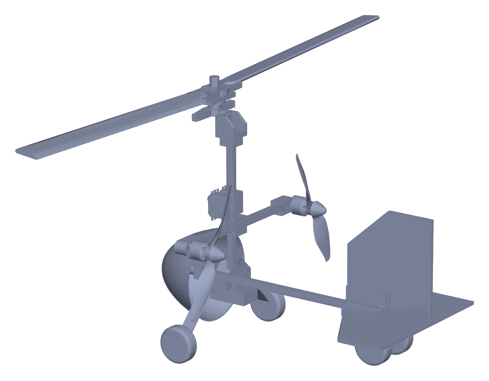
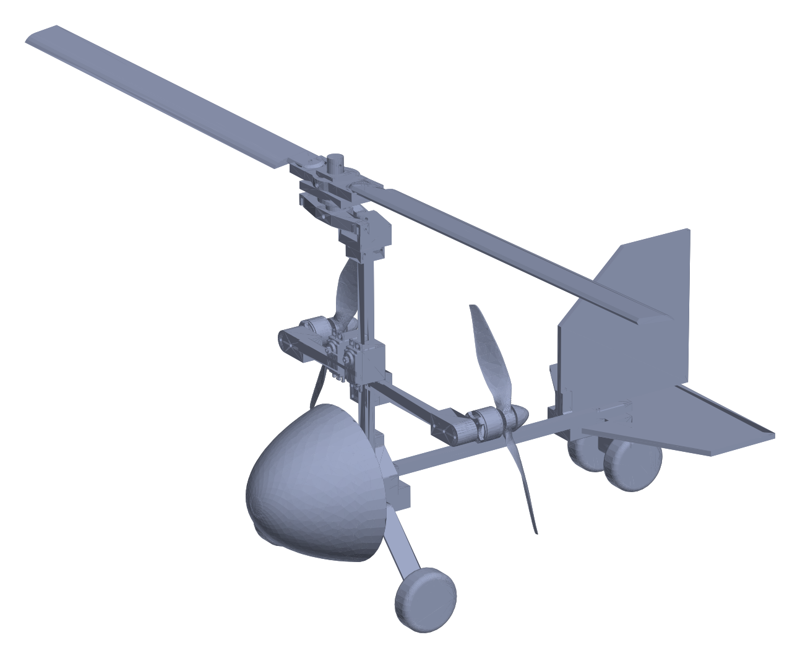
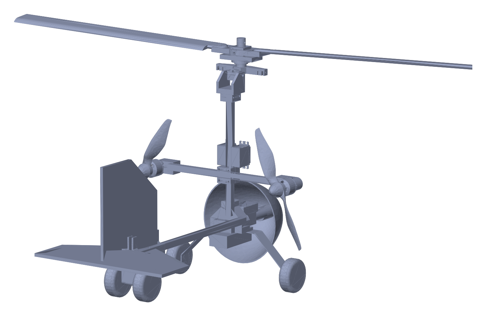
</p>
<p align="center"><sub>2호기 트윈붐 듀얼 푸셔 어셈블리 (<code>cad/exports/assembly_2_twin_boom.stp</code> 렌더링)</sub></p>

---

## 설계 개요

| 항목 | 내용 |
|---|---|
| 임무 | 표준 항로(Upwind → Crosswind → Downwind → Base) 비행 후 재이륙 가능한 안정 착륙 |
| 설계 목표 | **경량화**(양력 대비 중량비 개선)와 **자동회전 로터의 안정성** |
| 추진 방식 | 푸셔(Pusher): 동체 전방 유동을 방해하지 않고, 모터를 무게중심 근처에 배치 |
| 구조 | PLA 3D 프린팅 동체·마운트 + D15 카본봉(수직 300 mm / 수평 500 mm) + 폼보드 꼬리날개 |
| 로터 | Align 380 카본 블레이드 2엽, 티터링(teetering) 허브, 로터 직경 약 850 mm |
| 항전 | Pixhawk 6C Mini (PX4), PM02, R9DS 수신기, 텔레메트리, GPS, 서보 3개(롤·피치 2 + 러더 1) |

### 기체 버전

| | 1호기 (2025.07) | 2호기 (2025.08) |
|---|---|---|
| 형상 | 단발 푸셔 | **트윈붐 듀얼 푸셔** |
| CAD | [`cad/aircraft_v1_rotor_development`](cad/aircraft_v1_rotor_development) | [`cad/aircraft_v2_twin_boom`](cad/aircraft_v2_twin_boom) |
| 대표 어셈블리 | `banpozyro_.CATProduct`, `assembly_final_real.CATPart` | `assembly_2_twin_boom.CATProduct` |

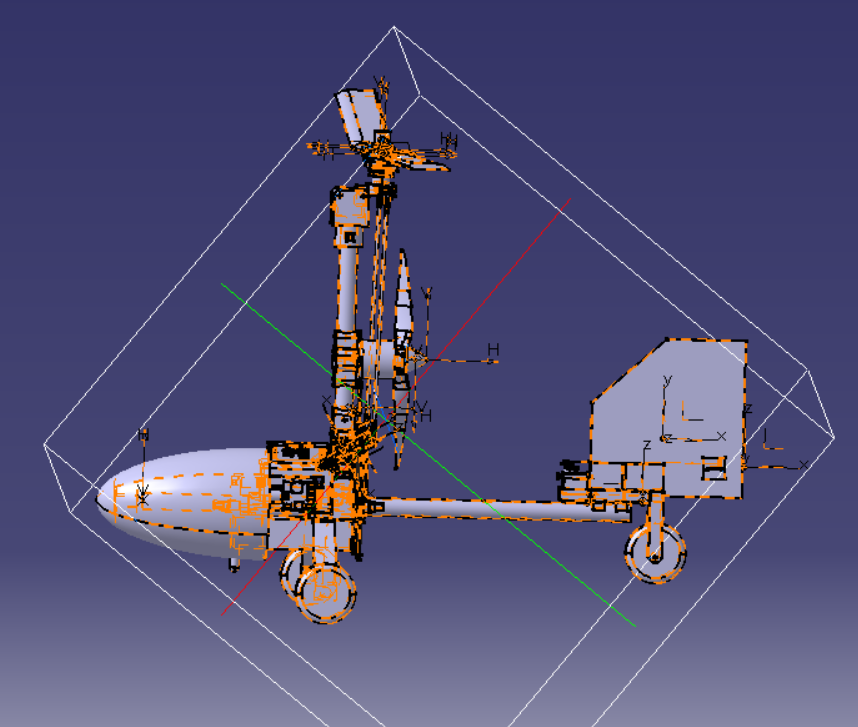

**무게중심**은 로터 축과 거의 일치하도록 배치해 로터 양력·항력에 의한 불필요한 모멘트를 줄였습니다. CG가 추력선보다 약 60 mm 낮아 생기는 음(−)의 피치 모멘트는 수평 꼬리날개로 보완했습니다(CATIA *Measure Inertia*로 확인).

<br clear="right">

---

## 로터 시스템

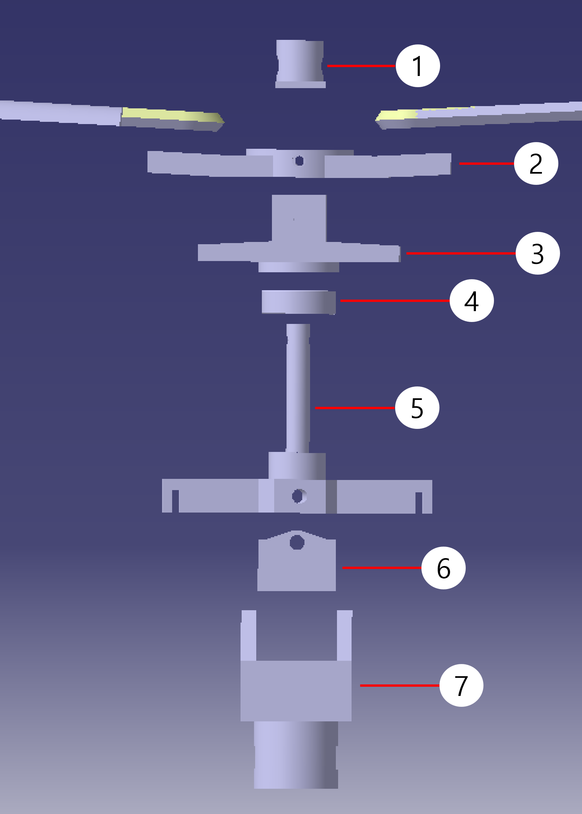

| # | 부품 | 역할 |
|---|---|---|
| 1 | 로터 고정핀 | 로터 헤드 이탈 방지 (M3 체결) |
| 2 | 로터 헤드 | 블레이드 결합, **코닝각(상반각) 1.5°** 부여로 블레이드 뿌리 굽힘 모멘트·진동 감소 |
| 3 | 로터 허브 | 볼베어링과 결합해 회전, 고정핀과 함께 **티터링 플랩 힌지** 역할로 전진/후퇴 블레이드 간 양력 비대칭 자동 보정 |
| 4 | 볼베어링 | 로터 자유회전 |
| 5 | 로터 롤링 마운트 | 회전축(Ø14.5 mm) + 양쪽 암의 클레비스로 서보 링키지 연결 → 롤/피치 조종 |
| 6 | 로터 엘리베이터 마운트 | 롤 축 고정 + 양쪽 M4 숄더볼트 축으로 피치(엘리베이션) 회전 |
| 7 | 로터-동체 커넥터 | 엘리베이터 마운트와 D15 수직 카본봉 연결 |

- **롤 제어**: 두 서보가 반대 방향으로 회전합니다.
- **피치 제어**: 두 서보가 같은 방향으로 회전합니다.
- **비대칭 양력 보상**: 로터 틸트 허브를 −3°, 로터 허브를 +3°로 설계했습니다. 전진 블레이드는 수평 기준 +6°, 후퇴 블레이드는 0°가 되어 양력 차이가 줄어듭니다.

<br clear="right">

<p>
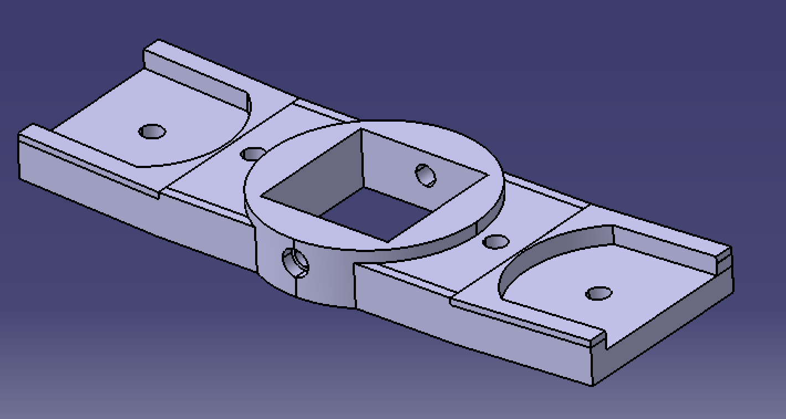
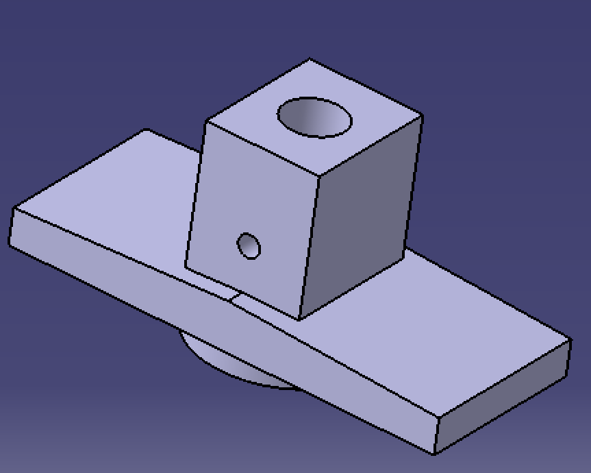
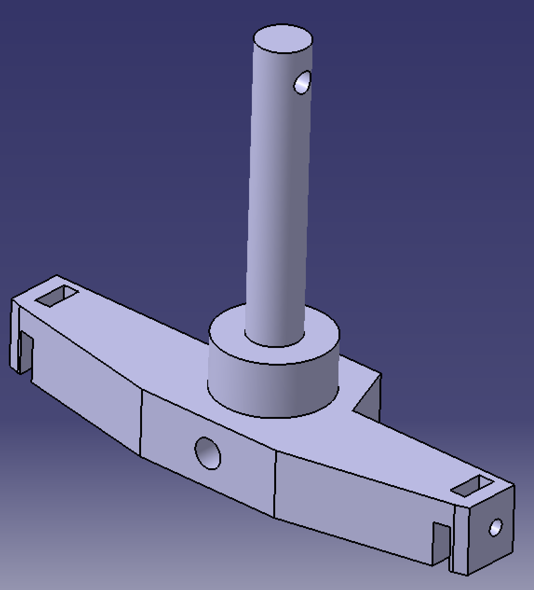
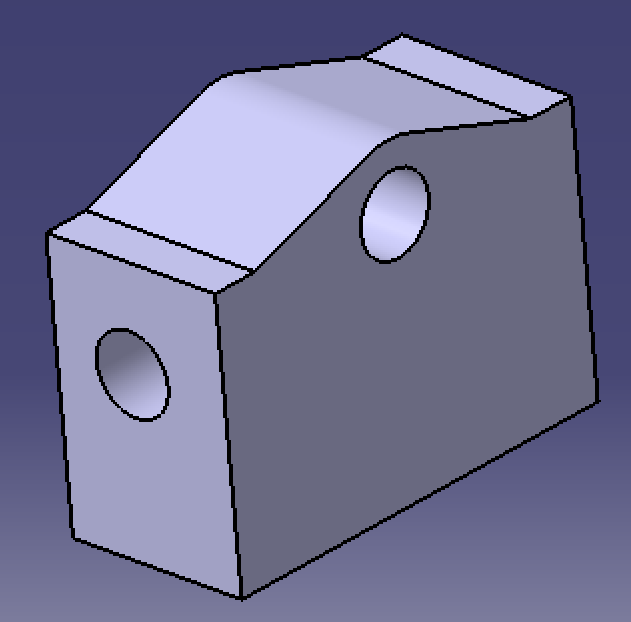
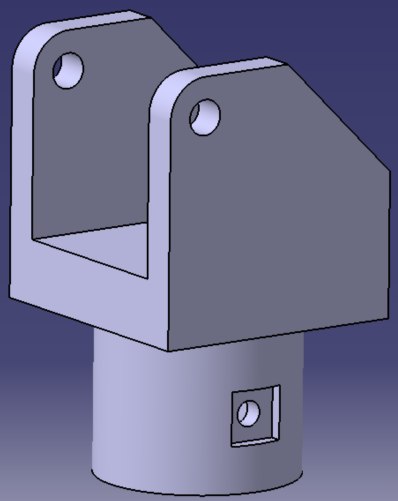
</p>

---

## 동체 · 꼬리날개 · 노즈콘

<p>
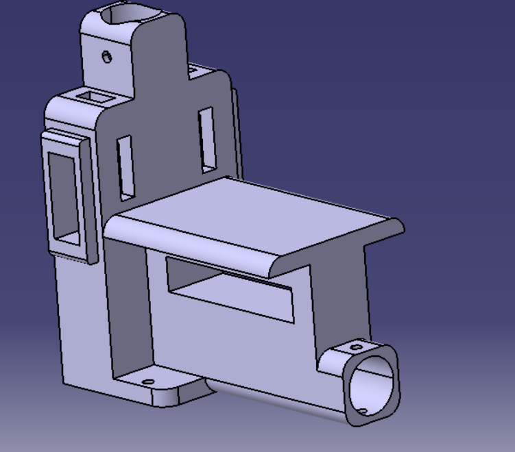
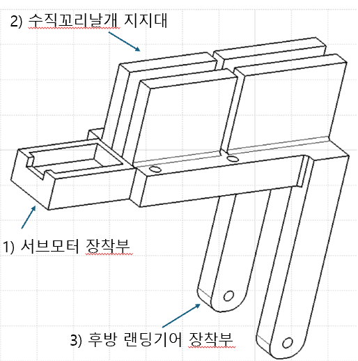
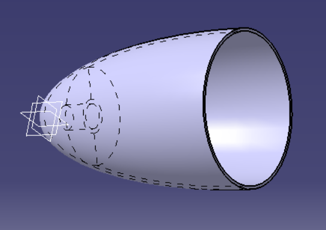
</p>

- **동체**: 모터 결합부를 중심으로 수직(로터)·수평(꼬리) 카본봉 인터페이스를 통합했습니다. PLA 3D 프린팅으로 제작했습니다.
- **꼬리날개**: 꼬리 프레임과 후방 랜딩기어 결합부를 일체형으로 만들어 부품 수를 줄였습니다.
  - 수직 꼬리날개 면적은 로터 디스크 면적의 **3.99 %**입니다(권장 범위 2~4 %).
  - 러더 면적은 수직 꼬리날개의 **72 %**이고, 서보로 ±20° 구동합니다.
- **노즈콘**: SimScale로 비압축성 15 m/s 유동을 해석해 타원 기울기각 15°~40°를 비교했습니다.
  - 항력이 가장 작은 **18° 형상(0.173 N)**을 채택했습니다.
  - 소재는 TPU 3D 프린팅입니다.

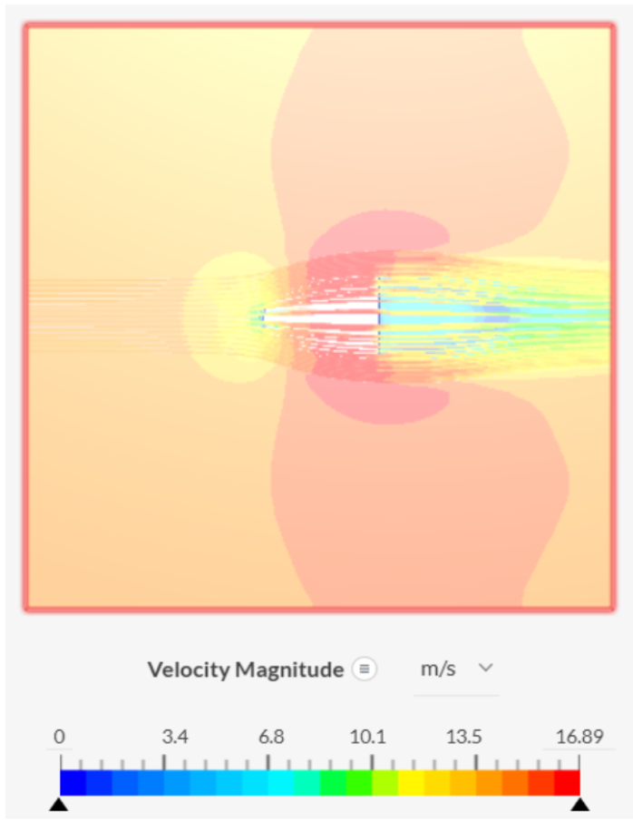

---

## 추진 · 항전

<p>
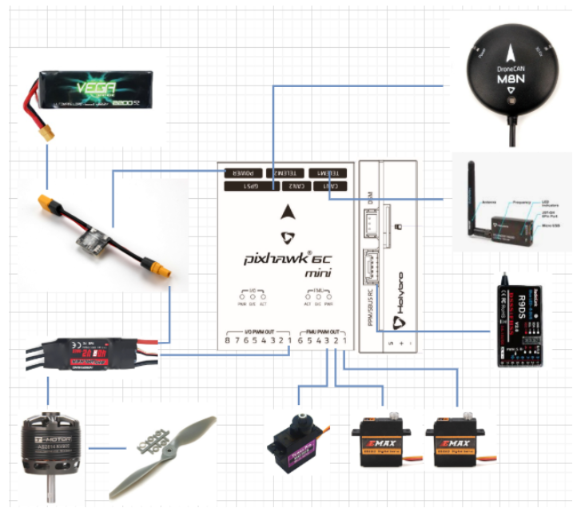
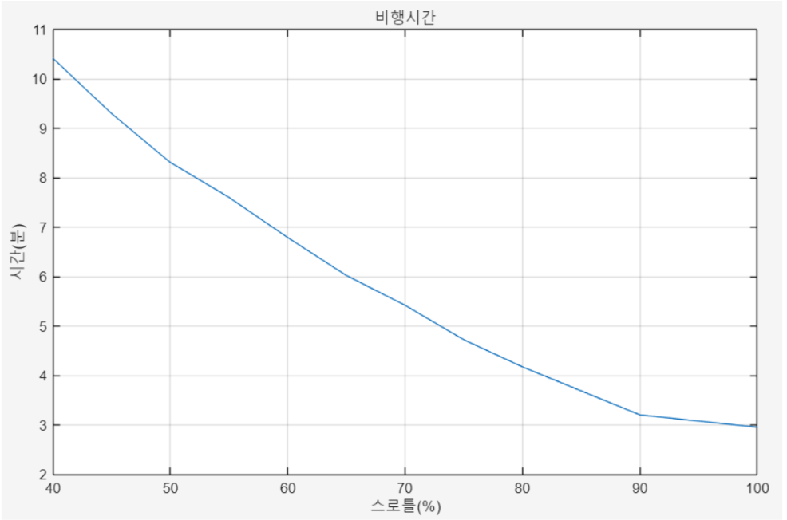
</p>

- **1호기 추진계**: T-Motor AS2814 KV900 + APC 9×6 프로펠러를 사용했습니다.
  - 제조사 데이터(APC 10×5.5) 기준 최대 추력은 약 1989 g입니다.
  - 기체 무게를 약 800 g으로 잡으면 **추력대비중량(TWR) ≈ 2.4**입니다.
- **2호기 추진계**: A2212 BLDC 모터 2개 + APC 8×8E 프로펠러의 트윈붐 듀얼 푸셔입니다.
- **비행시간**: 2200 mAh 3S 배터리를 80 %까지만 쓰고 주변기기 전류를 3 A로 가정했을 때, 스로틀 80 %에서 약 4분 이상을 목표로 했습니다.

---

## 폴더 구조

```
Modeling-Gyrocopter-/
├── cad/
│   ├── aircraft_v2_twin_boom/            # 2호기 (최종): assembly_2_twin_boom.CATProduct
│   │   ├── rotor/                        #   로터 헤드·허브·웨지·엘리베이터 파트, rotorhead.CATProduct
│   │   ├── fuselage_nosecone/            #   동체 프레임, 노즈콘(18°/23°)
│   │   ├── twin_boom/                    #   트윈붐 마운트, 트윈 모터 베이스
│   │   ├── tail/  landing_gear/  propeller/
│   │   └── electronics/                  #   Pixhawk 6C Mini, PM02, 수신기, 텔레메트리, 배터리, 모터, 서보
│   ├── aircraft_v1_rotor_development/    # 1호기 및 로터 반복 설계 (2025.07)
│   ├── early_rotorhead_study/            # 초기 로터헤드 연구 (2025.05–07)
│   └── exports/                          # 2호기 전체 어셈블리 STEP
├── print/                                # 3D 프린팅용 STL / 3MF (로터 부품)
└── docs/
    ├── reports/                          # 비행제작계획서
    ├── notes/                            # 체결부품 구매 목록, 재료 선정 메모
    └── images/
```

### CATIA 파일 열기

- CATIA V5에서 `.CATProduct`를 열 때 링크된 파트를 찾지 못하면 **File → Desk → Find**로 해당 폴더를 지정하면 다시 연결됩니다(파일명 기준으로 찾습니다).
- CATIA가 없으면 [`cad/exports/assembly_2_twin_boom.stp`](cad/exports/assembly_2_twin_boom.stp)를 FreeCAD, Fusion 등에서 열 수 있습니다.
- `electronics/`, `propeller/`, `servo/` 등 상용 부품은 공개 CAD 모델을 CATIA로 변환해 배치용으로 사용한 것입니다.

## 참고

- ThunderFly TF-G2 Autogyro, turbi *Giroprint 2020 monomotor* (초기 형상 참고)
- M. Wojtas, M. Trendak, *New gyroplane hub connector with positive coning angle*
